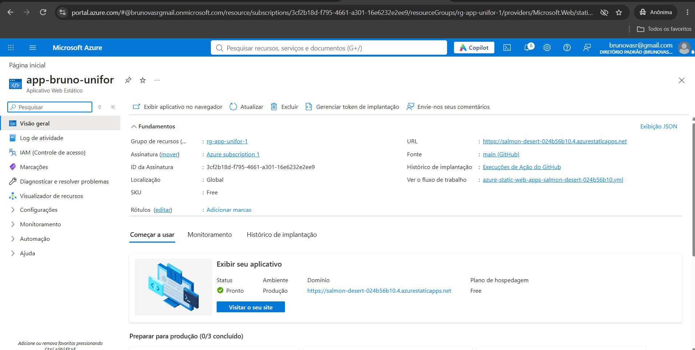
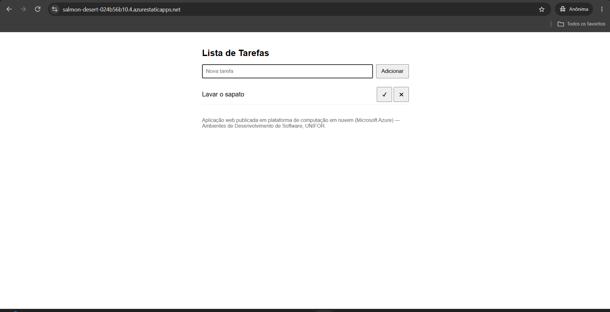

# Aplicação Web na Nuvem — Ambientes de Desenvolvimento de Software

**Aluno:** Bruno Vasconcelos Rocha
**Curso:** Análise e Desenvolvimento de Sistemas — UNIFOR
**Disciplina:** Ambientes de Desenvolvimento de Software

## Aplicação em operação

URL pública: **https://salmon-desert-024b56b10.4.azurestaticapps.net**

Aplicação web simples (Lista de Tarefas) em HTML, CSS e JavaScript, publicada no **Microsoft Azure** pelo serviço **Azure Static Web Apps** (plano gratuito), com implantação contínua a partir deste repositório via GitHub Actions.

## Atividade

1. Criar conta em uma plataforma de computação em nuvem.
2. Selecionar uma aplicação para desenvolvimento de uma aplicação Web.
3. Publicar a URL da aplicação em operação na plataforma.

### 1. Conta criada na plataforma de nuvem

Conta criada no Microsoft Azure, com a assinatura **Azure subscription 1** ativa.

### 2. Aplicação selecionada e criada

Foi criado o recurso **app-bruno-unifor** (Aplicativo Web Estático, plano Free), conectado ao branch `main` deste repositório.

Repositório no GitHub com o código da aplicação e o fluxo de trabalho gerado pelo Azure:

### 3. Aplicação em operação na nuvem

Página acessada pela URL pública:

Funcionamento — adicionar, concluir e remover tarefas:

## Estrutura do repositório

- `public/index.html` — aplicação publicada (as tarefas ficam salvas no navegador, via `localStorage`)
- `.github/workflows/` — fluxo de implantação do Azure Static Web Apps
- `server.js`, `package.json` — versão inicial com servidor Node/Express, usada no teste local
