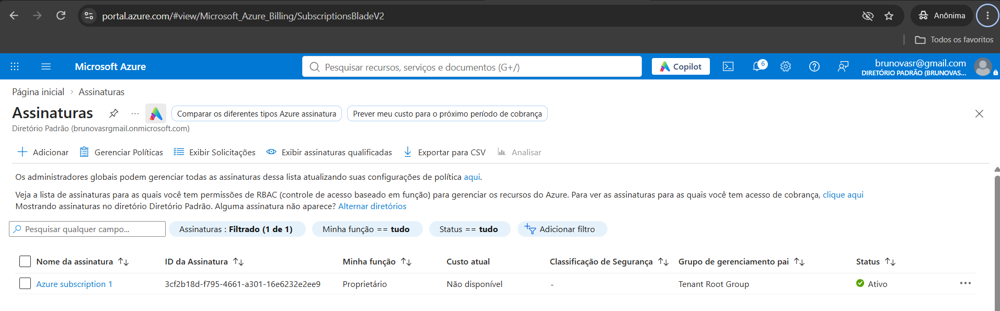
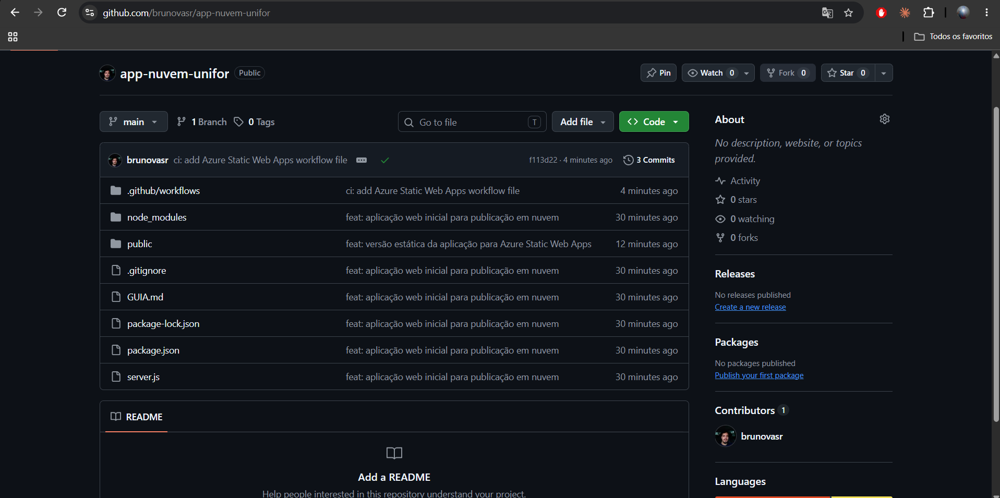
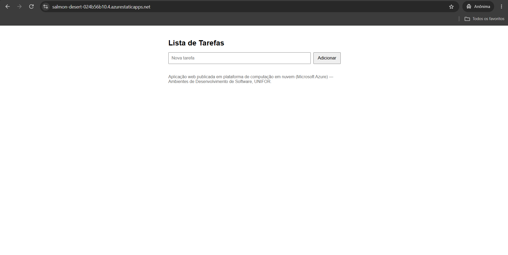
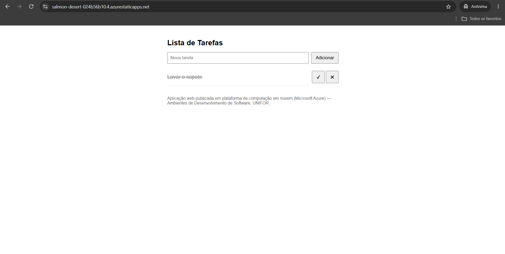
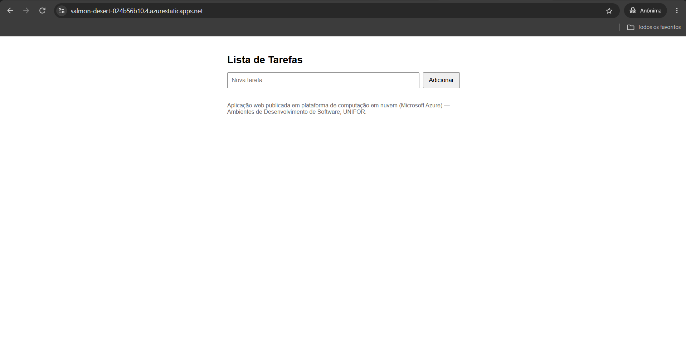

# Aplicação Web na Nuvem — Ambientes de Desenvolvimento de Software

**Aluno:** Bruno Vasconcelos Rocha
**Curso:** Análise e Desenvolvimento de Sistemas — UNIFOR
**Disciplina:** Ambientes de Desenvolvimento de Software

## Aplicação em operação

URL pública: **https://salmon-desert-024b56b10.4.azurestaticapps.net**

Aplicação web simples (Lista de Tarefas) em HTML, CSS e JavaScript, publicada no **Microsoft Azure** pelo serviço **Azure Static Web Apps** (plano gratuito), com implantação contínua a partir deste repositório via GitHub Actions.

## Atividade

1. Criar conta em uma plataforma de computação em nuvem.
2. Selecionar uma aplicação para desenvolvimento de uma aplicação Web.
3. Publicar a URL da aplicação em operação na plataforma.

### 1. Conta criada na plataforma de nuvem

Conta criada no Microsoft Azure, com a assinatura **Azure subscription 1** ativa.



### 2. Aplicação selecionada e criada

Foi criado o recurso **app-bruno-unifor** (Aplicativo Web Estático, plano Free), conectado ao branch `main` deste repositório.


Repositório no GitHub com o código da aplicação e o fluxo de trabalho gerado pelo Azure:



### 3. Aplicação em operação na nuvem

Página acessada pela URL pública:



Funcionamento — adicionar, concluir e remover tarefas:






## Requisitos atendidos (versão 2.0)

Sistema: **Gerenciador de Tarefas** com usuários, categorias e painel administrativo. Equipe individual (1 pessoa) → mínimo de 6 transações; o sistema possui **9**.

| Requisito | Como foi atendido |
|---|---|
| Equipe e transações | 9 transações: cadastrar usuário, login, criar categoria, criar / editar / concluir / excluir tarefa, alterar papel de usuário (admin), excluir usuário (admin) |
| Frontend | HTML, CSS, JavaScript e **React** (Vite) em `frontend/` |
| Backend | **Node.js + Express**, Web Service **REST** com rotas em `/api/*` (`backend/src/app.js`) |
| Controle de acesso | **Autenticação** com JWT (senhas com bcrypt) e **autorização** por papel (`usuario` / `admin`); cada usuário acessa só as próprias tarefas; rotas `/api/admin/*` só para admin. O primeiro usuário cadastrado vira admin |
| SGBD | **SQLite** (módulo nativo `node:sqlite`), esquema em `backend/src/db.js` |
| Controle de versão | Git/GitHub, com commits por etapa |
| Testes formais | 11 testes automatizados dos serviços (`node:test` + `supertest`) em `backend/test/` |

### Rotas da API

| Método | Rota | Acesso |
|---|---|---|
| POST | `/api/auth/registrar`, `/api/auth/login` | público |
| GET | `/api/auth/eu` | autenticado |
| GET/POST | `/api/categorias` | autenticado |
| GET/POST | `/api/tarefas` | autenticado |
| PUT/DELETE | `/api/tarefas/:id` | autenticado (dono) |
| PATCH | `/api/tarefas/:id/concluir` | autenticado (dono) |
| GET | `/api/admin/usuarios` | admin |
| PATCH | `/api/admin/usuarios/:id/papel` | admin |
| DELETE | `/api/admin/usuarios/:id` | admin |

### Como executar

Requer Node.js 22 ou superior.

```bash
npm run install:tudo   # instala dependências do backend e do frontend
npm test               # executa os testes formais da API
npm run build          # gera o frontend (frontend/dist)
JWT_SECRET=troque-isto npm start   # servidor em http://localhost:3000 (API + React)
```

Para desenvolvimento: `npm --prefix backend start` e, em outro terminal, `npm --prefix frontend run dev`.

Variáveis de ambiente: `PORT`, `JWT_SECRET` (obrigatório em produção) e `DB_FILE` (arquivo SQLite, padrão `dados.sqlite`).

> **Implantação:** o Azure Static Web Apps publica apenas o frontend (`frontend/dist`). A API Node precisa ser hospedada em um serviço de servidor (por exemplo, Azure App Service), pois o Static Web Apps não executa o Express.

## Estrutura do repositório

- `backend/` — API Node/Express, banco SQLite e testes (`backend/test/`)
- `frontend/` — aplicação React (Vite)
- `.github/workflows/` — fluxo de implantação do Azure Static Web Apps
- `docs/img/` — prints da publicação na nuvem (atividade anterior)
